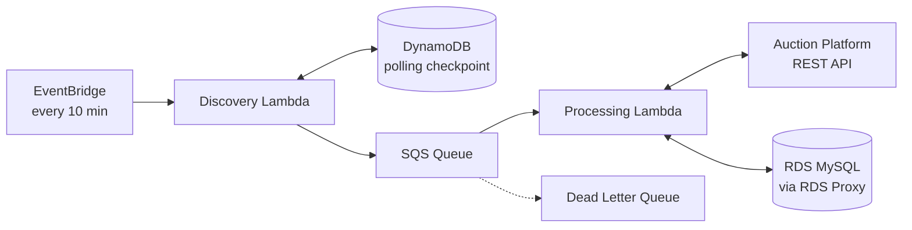

# Automated Auction Bidder: Architecture Design

Architecture document for a serverless application that automatically discovers auctions on an external Auction Platform and places bids on them within configured limits.

The full design is in **[Automated_Auction_Bidder_Architecture.docx](./Automated_Auction_Bidder_Architecture.docx)**.

## What the system does

- Polls the Auction Platform every 10 minutes and finds auctions that were created or modified.
- Queues each auction for processing, one auction per message.
- Calculates the next bid, either by reducing the platform's minimum bid by a configured amount or by using a pricing strategy.
- Checks the bid against a minimum threshold and a maximum number of attempts before submitting it.
- Records every bid attempt and the final auction state (WON or CLOSED).

## High-level flow

## Technology

| Area | Choice |
|---|---|
| Language | Java 17 (Maven, no Spring Boot) |
| Compute | AWS Lambda |
| Scheduling | Amazon EventBridge |
| Messaging | Amazon SQS with a Dead Letter Queue |
| Checkpoint store | Amazon DynamoDB |
| Database | Amazon RDS for MySQL with RDS Proxy |
| Monitoring | Amazon CloudWatch |

## What the document covers

1. Overview and scope
2. High-level architecture
3. Processing workflow, with an example negotiation
4. Sequence diagrams: auction discovery and auction processing
5. Logical object model and class responsibilities
6. Data design: auctions, bidding configuration and bids tables
7. Reliability and error handling
8. Performance and scalability
9. Design decisions and trade-offs

## Key design points

- **Polling checkpoint:** each run covers the window `[fromTime, toTime)`. The checkpoint in DynamoDB moves forward only after every auction ID is published to SQS, and it is updated conditionally so overlapping runs cannot overwrite a newer value.
- **No duplicate bids:** before placing a bid the Lambda reserves the attempt in the database as `PENDING` with a unique Request ID. A `UNIQUE (auction_id, attempt_number)` constraint and a row lock on the auction prevent concurrent submissions.
- **Bid statuses:** `PENDING` (recorded, not yet confirmed), `SUBMITTED` (acknowledged by the platform), `REJECTED` (refused by the platform).
- **Uncertain submissions:** if a submission times out, the bid stays `PENDING` and is verified using the same Request ID on the next attempt.
- **Failures:** messages that keep failing move to the Dead Letter Queue for investigation and replay.

## Status

This is a design document. It describes the architecture and does not include source code.

## Author

Pavithran
